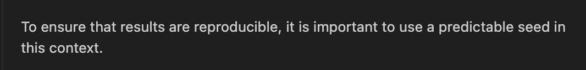

# Проблемы baseline_notebook.py

Список проблем, мешающих воспроизведению на другой машине:

1. Где брать данные? В коде указан абсолютный путь до csv файла (строка 15)
```python
df = pd.read_csv("/Users/anna/Desktop/работа/данные/churn_final_v3_ПОСЛЕДНИЙ.csv")
```
2. По сути из первого шага следует второй, даже если бы и был указан путь относительный, то данных для запуска скрипта все равно нет
3. `dropna()` удаляет все строки с любыми пропусками. То есть может удалить важные данные, если есть достаточно много пропусков по разным столбцам. Обычно заполняют пропуски медианным значением для числовых данных и `none` для категориальных.
4. С 19 по 24 строку замена категориальных значений на численные происходит явно, что может стать проблемой, если в датасете появятся другие значения, отличные от тех что прописаны в коде. Вместо ручной трансформации используют метод по типу One-Hot Encoding.
5. Проблемы выдал sonarqube: random_state нет в `train_test_split` и в `RandomForestClassifier`. Рекомендуется использовать `random_state` для воспроизводимости результатов. 
6. Захардкоженные гиперпараметры — их нельзя менять без правки кода и невозможно отслеживать эксперименты.
7. Не сохраняются ни модель, ни метрики — метрика просто печатается в консоль, сохранение закомментировано, а pickle.dump сохранил бы «голую» модель без препроцессинга (ещё и без with open(...))
